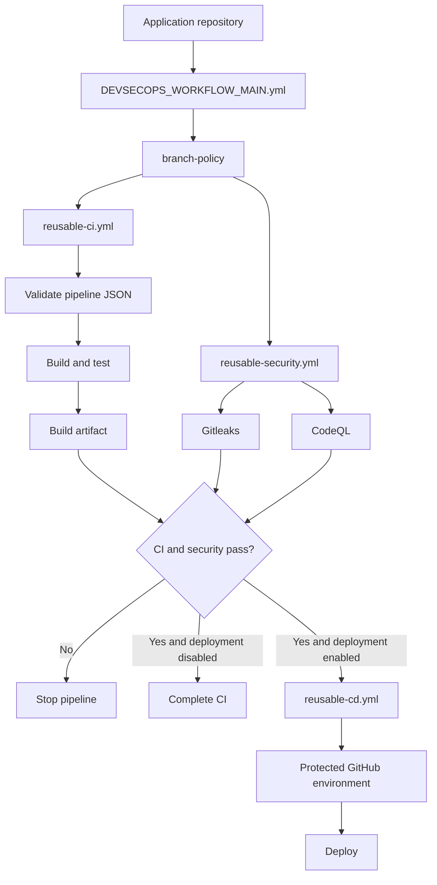
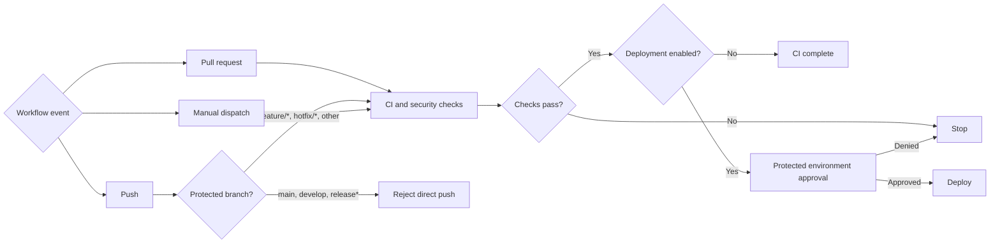

# DevSecOps pipeline overview

## Purpose

This repository provides a reusable GitHub Actions pipeline for application
repositories. It separates the application caller workflow from centrally
maintained CI, security, and CD workflows.

## Pipeline architecture



## End-to-end flow

```text
Application repository
  |
  | .github/templates/pipeline_dso.yaml (copy to application repository)
  v
DEVSECOPS_WORKFLOW_MAIN.yml
  |
  +--> branch-policy
  |      Reject direct pushes to protected branches
  |
  +--> reusable-ci.yml
  |      Checkout without persisted credentials
  |      Validate .github/pipeline/*.json
  |      Build and test
  |      Upload the reviewed build artifact
  |
  +--> reusable-security.yml
  |      Gitleaks secret scan
  |      CodeQL static analysis
  |
  +--> reusable-cd.yml
         Runs only when explicitly enabled
         Requires CI and security success
         Uses a protected GitHub environment
```

## Branch and deployment decision flow



## Event behavior

| Event | CI | Security | CD |
| --- | --- | --- | --- |
| Pull request to `main`, `develop`, or `release/*` | Yes | Yes | No |
| Push to any branch | Yes | Yes | No |
| Manual dispatch | Yes | Yes | Only when enabled |

The repository ruleset is the authoritative control that blocks direct pushes
to `main`, `develop`, `release`, and `release/*`. The workflow branch-policy
job is a fail-closed detection backstop.

## Application setup

Copy these files into the application repository:

```text
.github/templates/pipeline_dso.yaml (copy to application repository)
.github/pipeline/build-list.json
.github/pipeline/deployment-targets.json
```

Update the central workflow reference in `.github/templates/pipeline_dso.yaml` to a reviewed
commit SHA. Configure the build inputs for the application stack:

```yaml
with:
  build-command: npm run build
  test-command: npm test
  artifact-path: dist
  artifact-name: web-dist
```

For Python applications, use the Python composite action or provide a reviewed
test command. Do not place credentials, access tokens, passwords, or private
keys in either JSON file.

## Configuration responsibilities

`build-list.json` describes build and test intent and artifact paths.
`deployment-targets.json` describes approved environments and destinations.
These files are validated before project commands run, but they are not a
secret store and should not be treated as authorization.

Deployment authorization comes from GitHub environment protection rules,
reviewers, scoped secrets, and the workflow's explicit deployment condition.

## Release and rollback

Before enabling CD:

1. Create the matching GitHub environment.
2. Add required reviewers and environment protection rules.
3. Configure only the minimum provider credentials.
4. Define and test a rollback procedure.
5. Enable deployment from a trusted branch or manual dispatch.

If a deployment fails, keep the failed run and artifact evidence, disable CD
for the affected environment, and use the provider's rollback procedure.
Never bypass a failed security gate by weakening the workflow.

## Maintenance checklist

- Pin central workflow and third-party action references to full commit SHAs.
- Review permissions whenever a job or action changes.
- Add new security gates as reusable jobs rather than duplicating YAML.
- Update application callers only after central workflow review.
- Retain scan results, SBOMs, and release attestations as evidence.
- Review free-tier limits and provider terms before production deployment.
